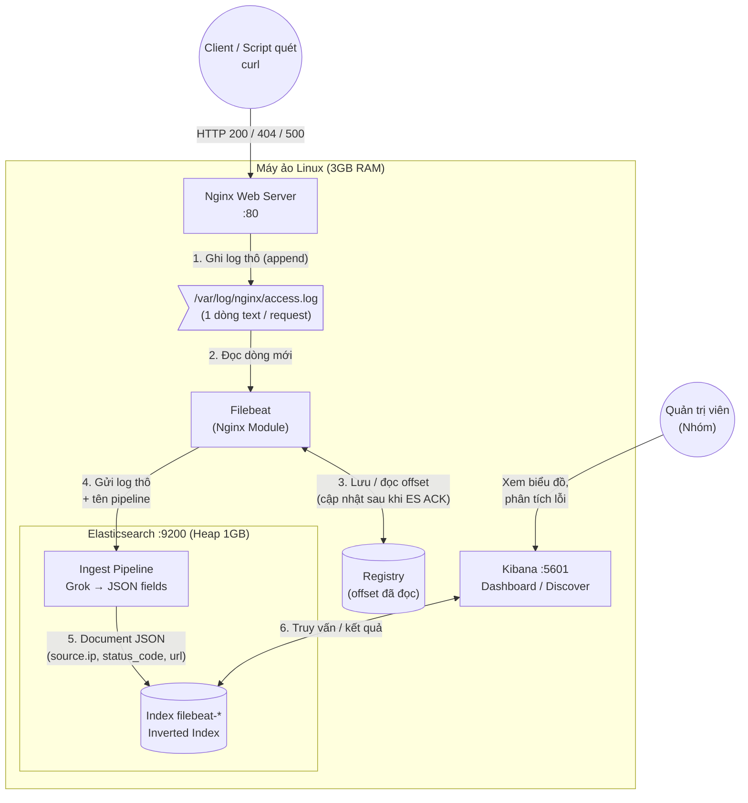

# ELK_Stack

**Hệ thống quản lý log tập trung** dùng Filebeat, Elasticsearch và Kibana, triển khai trên một máy ảo Linux (Azure). Đây là đồ án nhóm môn Linux, mô phỏng cách một đội vận hành thu thập, lưu trữ, phân tích và điều tra sự cố từ log của web server.

## Bài toán

Khi hệ thống có nhiều máy chủ, log nằm rải rác trên từng máy. Muốn tìm một lỗi phải SSH vào từng nơi rồi `grep` thủ công, rất chậm và dễ bỏ sót. Đồ án giải quyết bằng cách gom log về một chỗ, biến chúng thành dữ liệu có cấu trúc để tìm kiếm và vẽ biểu đồ.

## Kiến trúc



| Thành phần | Vai trò |
|---|---|
| **Nginx** | Web server, nguồn sinh log |
| **Filebeat** | Đọc `access.log`, gửi thẳng vào Elasticsearch, dùng Registry để không mất log |
| **Elasticsearch** | Parse log thành JSON (Ingest Pipeline), lưu trữ và đánh chỉ mục |
| **Kibana** | Tìm kiếm (Discover) và dựng dashboard |

**Yêu cầu hạ tầng:** 1 VM, Java Heap của Elasticsearch giới hạn 1GB, tắt X-Pack Security (chỉ dùng cho môi trường demo).

## Demo

| Demo | Nội dung |
|---|---|
| 1. Đẩy và parse log | Bóc tách log thô thành các trường IP, mã trạng thái, URL |
| 2. Dashboard Kibana | Biểu đồ request theo thời gian, biểu đồ tròn các mã 200/404/500 |
| 3. Điều tra sự cố | Giả lập quét lỗ hổng bằng `curl`, tìm IP gây nhiều lỗi 404 nhất và các URL bị quét |
| 4. Troubleshooting | Dừng Elasticsearch 3 phút, bật lại và dùng Registry chứng minh log không bị mất |

## Cấu trúc thư mục

```
infra/     Cấu hình hạ tầng (Elasticsearch, Kibana, Filebeat, Nginx) và script vận hành
traffic/   Script sinh traffic giả cho các demo
demos/     4 demo: cách chạy, kết quả, bằng chứng
docs/      Lý thuyết và quy ước nhóm
report/    Báo cáo (LaTeX)
slides/    Slide thuyết trình
```

```
ELK-Stack/
├── docs/                              # Tài liệu và hướng dẫn đồ án
│   ├── diagrams/                      # Sơ đồ kiến trúc hệ thống
│   │   ├── architecture.mmd           # Sơ đồ kiến trúc bằng Mermaid
│   │   └── architecture.md            # Giải thích kiến trúc hệ thống
│   ├── guides/                        # Hướng dẫn dành cho thành viên
│   │   ├── TEAMMATE_CONNECTION.md     # Hướng dẫn SSH vào Azure VM
│   │   └── VM_BASIC_COMMANDS.md       # Các lệnh quản lý VM cơ bản
│   ├── handoffs/                      # Tài liệu tổng hợp công việc
│   │   ├── phase1-elasticsearch.md    
│   │   └── phase1-nginx-filebeat.md   
│   ├── presentation/                  # Tài liệu thuyết trình
│   │   └── canva.md                   
│   └── report/                        # Báo cáo đồ án
│       └── report.md                  
├── evidences/                         # Hình ảnh và bằng chứng kiểm thử
│   ├── phase_01/                      
│   │   ├── 01-vm-elasticsearch/       
│   │   ├── 02-nginx-filebeat/         
│   │   ├── 03-kibana/                 
│   │   └── 04-traffic-scripts/        
│   └── phase_02/                      # Bằng chứng thực hiện demo
│       ├── demo1/                     
│       ├── demo2/                     
│       ├── demo3/                     
│       └── demo4/                     
├── infrastructure/                    # Cấu hình và vận hành hệ thống
│   ├── elasticsearch/                 
│   ├── filebeat/                      
│   ├── kibana/                        
│   ├── nginx/                         
│   └── scripts/                       
├── traffic/                           # Script sinh traffic HTTP giả lập
└── README.md                          # Giới thiệu và hướng dẫn dự án
```
