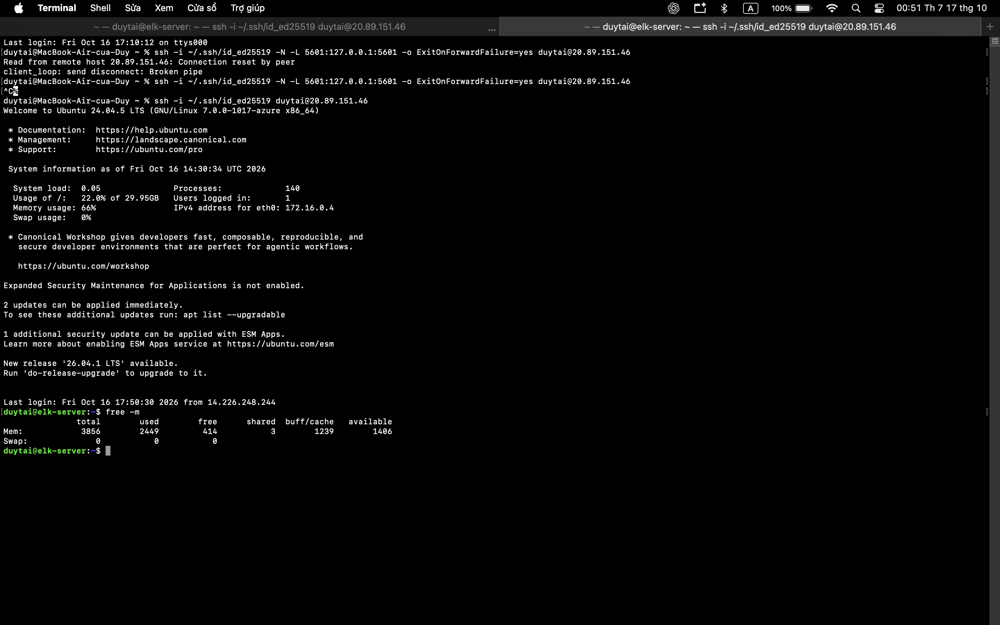
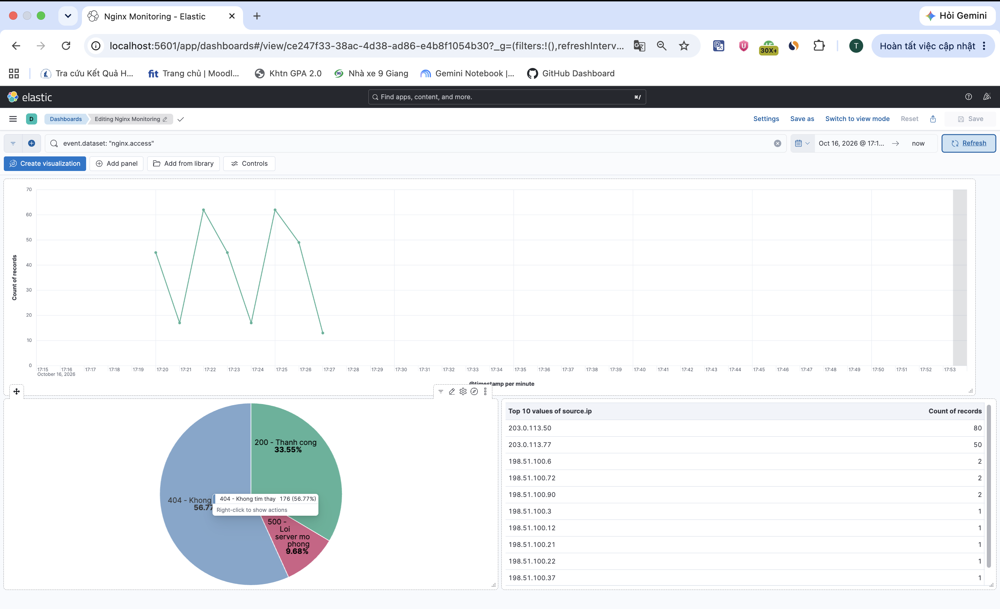
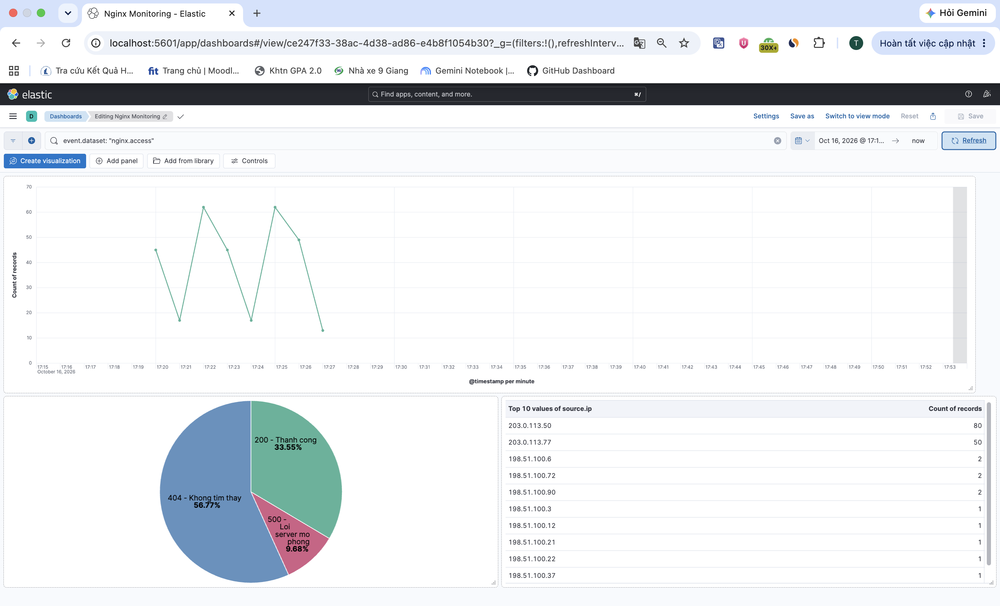

# Demo 2: Dựng dashboard giám sát Nginx trên Kibana

**Người thực hiện:** Lê Duy Tài.

**Video Demo 2 và 3:** [Xem trên Google Drive](https://drive.google.com/file/d/1OyUEoMq3qtPw9GE2QRtucNcMkAJlXoEL/view?usp=sharing).

## 1. Kết nối VM và mở Kibana

Đăng nhập VM từ Terminal trên Mac:

```bash
ssh -i ~/.ssh/id_ed25519 duytai@20.89.151.46
```

Mở tab Terminal khác trên Mac để tạo SSH tunnel:

```bash
ssh -i ~/.ssh/id_ed25519 -N -L 5601:127.0.0.1:5601 -o ExitOnForwardFailure=yes duytai@20.89.151.46
```

Giữ tunnel hoạt động và truy cập [Kibana](http://localhost:5601).

## 2. Tạo dữ liệu mô phỏng và kiểm tra RAM

Trong thư mục `traffic` trên VM, chạy:

```bash
bash mix_traffic_demo23.sh 5 60
```

Script tạo **310 request**, chia thành 5 đợt, nghỉ 60 giây giữa các đợt: 150 request khách thường, 80 từ IP `203.0.113.50`, 50 từ IP `203.0.113.77` và 30 request tới `/error` để mô phỏng mã 500.

Sau lần chạy, kiểm tra RAM trên VM:

```bash
free -m
```

Kết quả tại thời điểm đo: tổng **3856 MiB**, đang dùng **2449 MiB**, available **1406 MiB**, swap **0**.



## 3. Chọn dữ liệu trên Kibana

1. Chọn Data View **nginx logs**, sử dụng pattern `filebeat-*` và trường thời gian `@timestamp`.
2. Đặt khoảng thời gian tuyệt đối: **16/10/2026, 17:18:03.051–17:28:08.571 (UTC+7)**.
3. Nhập bộ lọc KQL:

```text
event.dataset: "nginx.access"
```

## 4. Tạo biểu đồ request theo thời gian

1. Vào **Dashboards → Create dashboard → Create visualization**.
2. Chọn Data View **nginx logs**, loại biểu đồ **Line** và bộ lọc ở bước 3.
3. Cấu hình trục ngang: `@timestamp`, **Date histogram**, khoảng thời gian **1 minute**.
4. Cấu hình trục dọc: **Count of records**.
5. Bấm **Save and return**, lưu dashboard với tên **Nginx Monitoring**.

Biểu đồ thể hiện số request theo từng phút trong lần chạy.

## 5. Tạo biểu đồ phân bố mã HTTP

1. Trong dashboard, chọn **Edit → Create visualization**, loại **Pie**.
2. Đặt **Slice size / Metric** thành **Count of records**.
3. Trong **Slice by → Filters**, tạo ba bộ lọc:

| Nhãn | KQL |
|---|---|
| 200 - Thành công | `http.response.status_code: 200` |
| 404 - Không tìm thấy | `http.response.status_code: 404` |
| 500 - Lỗi server mô phỏng | `http.response.status_code: 500` |

4. Bật hiển thị nhãn và phần trăm, bấm **Save and return**.

Kết quả của lần thực hành:

| Mã HTTP | Số request | Tỷ lệ |
|---|---:|---:|
| 200 | 104 | 33,55% |
| 404 | 176 | 56,77% |
| 500 | 30 | 9,68% |
| **Tổng** | **310** | **100%** |



## 6. Lưu dashboard

Sắp xếp biểu đồ đường phía trên, biểu đồ tròn phía dưới. Giữ KQL chung là `event.dataset: "nginx.access"`, bấm **Save → Switch to view mode**. Bảng Top IP được bổ sung theo [Demo 3](../demo3/README.md).


