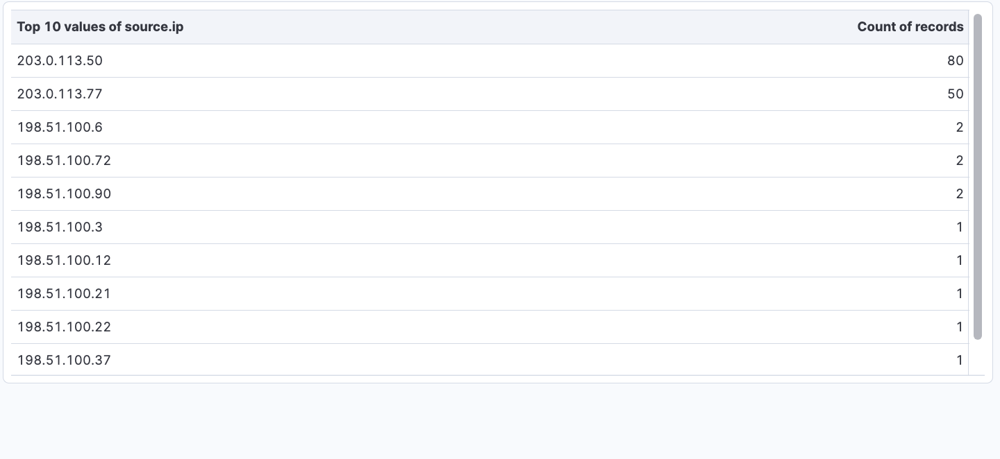
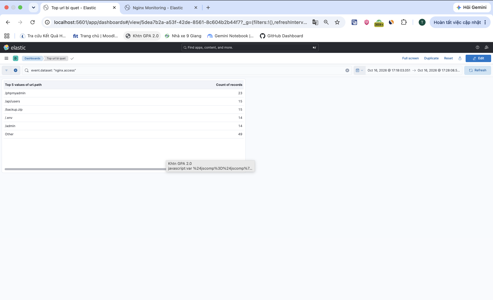
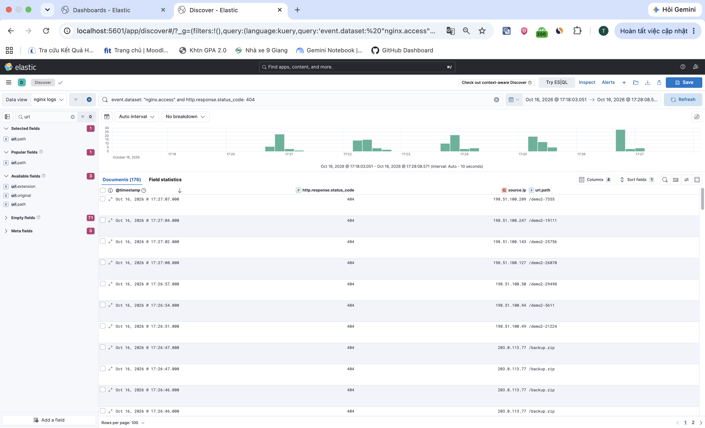
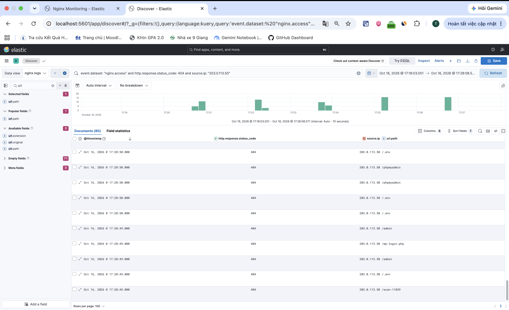

# Demo 3: Phân tích log và truy vết IP trên Kibana

**Người thực hiện:** Lê Duy Tài.

**Video Demo 2 và 3:** [Xem trên Google Drive](https://drive.google.com/file/d/1OyUEoMq3qtPw9GE2QRtucNcMkAJlXoEL/view?usp=sharing).

## 1. Chọn dữ liệu phân tích

Sử dụng dữ liệu mô phỏng đã tạo ở [Demo 2](../demo2/README.md), Data View **nginx logs**, khoảng thời gian **16/10/2026, 17:18:03.051–17:28:08.571 (UTC+7)** cho tất cả bảng và truy vấn.

## 2. Tạo bảng Top IP có nhiều request 404

1. Mở **Nginx Monitoring → Edit → Create visualization**.
2. Chọn **nginx logs**, loại **Table**, nhập KQL:

```text
event.dataset: "nginx.access" and http.response.status_code: 404
```

3. Cấu hình **Rows**: Top values của `source.ip`, lấy **10** giá trị.
4. Cấu hình **Metrics**: Count of records; sắp xếp theo số đếm **Descending**.
5. Bấm **Save and return**, lưu bảng vào dashboard. Giữ bộ lọc 404 riêng trong bảng, KQL chung của dashboard là `event.dataset: "nginx.access"`.

Kết quả hai IP đứng đầu:

| IP | Request 404 |
|---|---:|
| `203.0.113.50` | 80 |
| `203.0.113.77` | 50 |



## 3. Tạo bảng Top URL bị quét

1. Tạo visualization mới, chọn **nginx logs**, loại **Table**.
2. Lọc request 404 của hai IP mô phỏng:

```text
event.dataset: "nginx.access" and http.response.status_code: 404 and source.ip: ("203.0.113.50" or "203.0.113.77")
```

3. Cấu hình **Rows**: Top values của `url.path`, lấy **5** giá trị, bật nhóm **Other**.
4. Cấu hình **Metrics**: Count of records; sắp xếp theo số đếm **Descending**.
5. Bấm **Save and return**, lưu trong dashboard **Top url bi quet**.

| URL | Request |
|---|---:|
| `/phpmyadmin` | 23 |
| `/api/users` | 15 |
| `/backup.zip` | 15 |
| `/.env` | 14 |
| `/admin` | 14 |
| Other | 49 |
| **Tổng** | **130** |

Nhóm **Other** gồm các URL ngoài Top 5. Tổng 130 khớp số request của hai IP: 80 + 50.



## 4. Lọc request 404 trong Discover

1. Mở **Discover**, chọn **nginx logs** và cùng khoảng thời gian ở bước 1.
2. Nhập KQL:

```text
event.dataset: "nginx.access" and http.response.status_code: 404
```

3. Thêm các cột `@timestamp`, `source.ip`, `url.path`, `http.response.status_code`.
4. Kiểm tra **Documents**: có **176** request 404, trong đó 130 từ hai IP mô phỏng và 46 từ các IP còn lại.



## 5. Truy vết IP đứng đầu

Trong Discover, thêm điều kiện IP:

```text
event.dataset: "nginx.access" and http.response.status_code: 404 and source.ip: "203.0.113.50"
```

Kết quả còn **80 bản ghi**, khớp bảng Top IP. Quan sát các cột đường dẫn và thời gian: IP này truy cập `/.env`, `/admin`, `/phpmyadmin`, `/wp-login.php`; nhiều request xuất hiện trong cùng một giây.



Kết quả thể hiện hành vi quét trong dữ liệu mô phỏng. Hướng xử lý đề xuất là xác minh nguồn truy cập và ngữ cảnh trước khi giới hạn tần suất hoặc chặn IP theo chính sách.
