# Demo 4 – Minh chứng Kiểm thử Khả năng Chịu lỗi (Fault Tolerance) & Cơ chế Registry

> **Kịch bản:** Dừng Elasticsearch trong 3 phút trong khi Web Server Nginx vẫn nhận traffic; khởi động lại Elasticsearch và kiểm tra cơ chế **Registry của Filebeat** để chứng minh dữ liệu log được gửi bù đầy đủ 100%, không bị mất bất kỳ bản ghi log nào.

---

## 0. Kiểm tra Ràng buộc Tài nguyên Hệ thống ($\le$ 3GB RAM)

* **Thao tác:** Kiểm tra mức RAM đang sử dụng (`free -h`) và file cấu hình Java Heap của Elasticsearch.
* **Mô tả:** Hệ thống tiêu thụ `2.6 GiB` ($\le$ 3GB theo yêu cầu). Giới hạn Heap của Elasticsearch ở mức `1GB` (`-Xms1g -Xmx1g`).

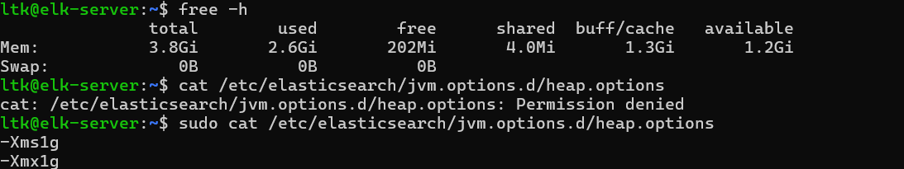

---

## Bước 1. Khởi tạo & Lấy mốc ban đầu (Baseline)

* **Thao tác:** Kiểm tra 4 dịch vụ (`active`), đếm số dòng log Nginx và số document Elasticsearch trước khi thử nghiệm.

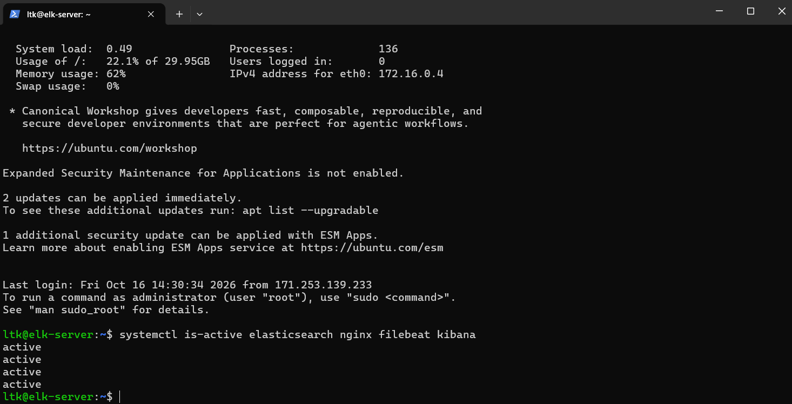

* File log Nginx ban đầu sạch (`0` dòng):


* Elasticsearch hiện có sẵn `527` documents (tích lũy từ các phase trước):

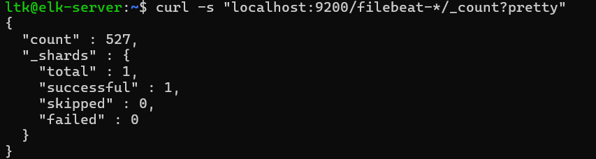

* **Kiểm tra cơ chế Registry mốc ban đầu (T0 - Trước sự cố):**
  * Lệnh thực hiện:
    ```bash
    sudo stat -c "Kích thước access.log: %s bytes" /var/log/nginx/access.log
    sudo tail -n 3 /var/lib/filebeat/registry/filebeat/log.json
    ```
  * **Quan sát:** Kích thước file `access.log` là `0 bytes`. Trong Registry chưa có offset mới của `access.log` (trạng thái sạch đồng bộ với baseline).

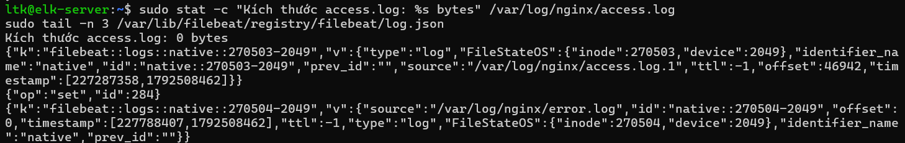

---

## Bước 2. Giả lập sự cố Elasticsearch (Outage)

* **Thao tác:** Tắt dịch vụ Elasticsearch (`systemctl stop elasticsearch`). Hệ thống xác nhận trạng thái `inactive`.

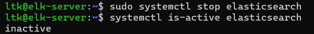

---

## Bước 3. Bơm Traffic kiểm thử & Chứng minh Registry Đóng Băng

* **Thao tác:** Chạy `outage_test.sh` bơm 50 request kiểm thử (`/outage-test-*`) trong khi Elasticsearch đang tắt (kéo dài khoảng 3 phút).
* **Video quá trình chạy script:** [`demo4_fault_tolerance.mp4`](./demo4_fault_tolerance.mp4)

* Filebeat phát hiện mất kết nối (`connection refused`), lưu log vào hàng đợi và kích hoạt cơ chế `Exponential Backoff Retry`:

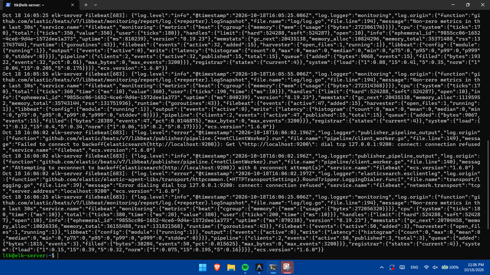

* Web Server Nginx vẫn hoạt động độc lập và ghi nhận đủ 50 log `/outage-test-...` (mã 404):

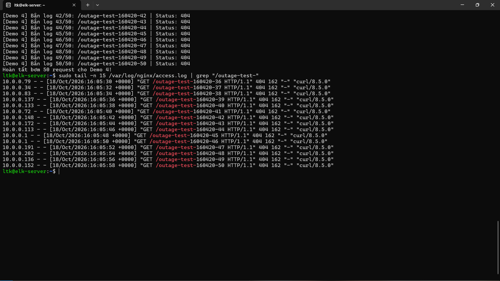

* **Kiểm tra cơ chế Registry trong sự cố (T1 - Trong lúc ES tắt):**
  * Lệnh thực hiện:
    ```bash
    sudo stat -c "Kích thước access.log: %s bytes" /var/log/nginx/access.log
    sudo tail -n 3 /var/lib/filebeat/registry/filebeat/log.json
    ```
  * **Quan sát:** Kích thước `access.log` đã phình to lên **`5318 bytes`** do ghi nhận thêm 50 requests mới. Tuy nhiên, vì Elasticsearch đang tắt không thể gửi ACK, Filebeat **hoàn toàn đóng băng Registry offset** (không có bản ghi offset 5318 nào được commit trong registry).

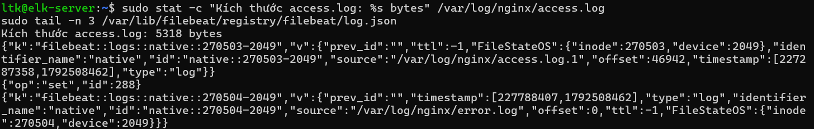

---

## Bước 4. Khôi phục dịch vụ Elasticsearch & Bù dữ liệu (Recovery)

* **Thao tác:** Bật lại Elasticsearch (`systemctl start elasticsearch`). Cụm phục hồi `active` và cluster health đạt `green`.

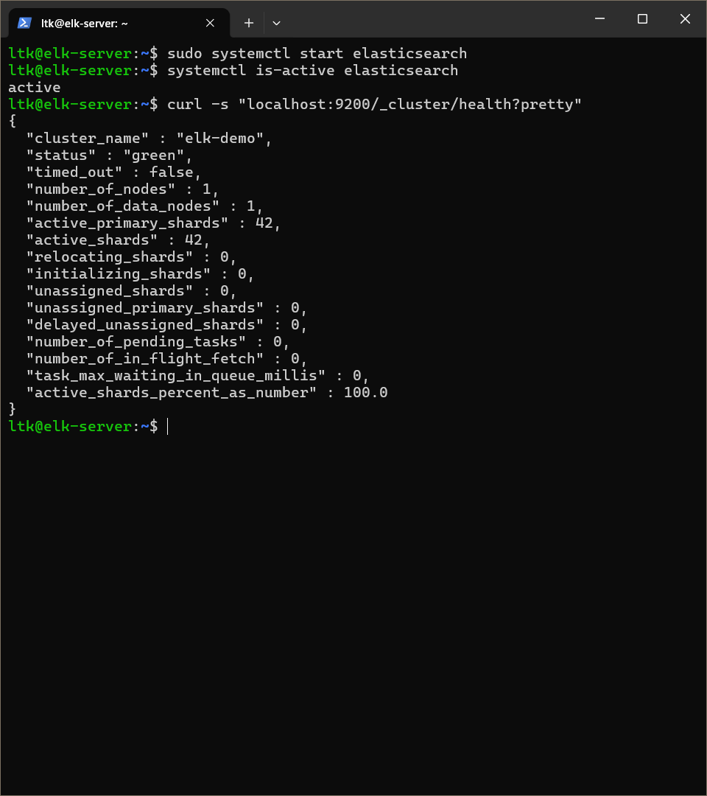

* **Kiểm tra cơ chế Registry sau phục hồi (T2 - Sau khi ES bật lại):**
  * Lệnh thực hiện:
    ```bash
    sudo stat -c "Kích thước access.log: %s bytes" /var/log/nginx/access.log
    sudo tail -n 5 /var/lib/filebeat/registry/filebeat/log.json
    ```
  * **Quan sát:** Khi Elasticsearch hoạt động trở lại, Filebeat tự động đọc tiếp từ offset cũ, gửi bù toàn bộ các dòng log bị trễ, nhận ACK và cập nhật offset trong Registry **đuổi kịp chính xác kích thước file `5318 bytes`** (`"source":"/var/log/nginx/access.log", "offset":5318`).

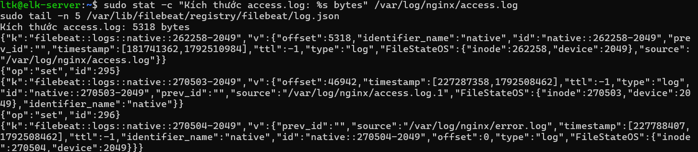

---

## Bước 5. Đối chiếu Toàn vẹn Dữ liệu & Trực quan hóa (Reconciliation)

### Bảng tổng hợp diễn biến Cơ chế Registry qua 3 thời điểm:

| Thời điểm | Trạng thái ES | Hành động traffic | Kích thước `access.log` | Trạng thái Registry Offset | Đánh giá kỹ thuật |
| :--- | :---: | :--- | :---: | :---: | :--- |
| **T0: Trước sự cố** | Running | Baseline sạch | `0 bytes` | `0` (đồng bộ) | Hệ thống ở trạng thái baseline sạch. |
| **T1: Trong sự cố (3 phút)** | **STOPPED** | Bơm 50 requests | `5318 bytes` | **Đứng yên (chưa commit 5318)** | ES không phản hồi ACK &rarr; Registry không dịch chuyển con trỏ. |
| **T2: Sau phục hồi** | Running | Khôi phục cụm | `5318 bytes` | **Đuổi kịp (`5318 bytes`)** | Gửi bù toàn bộ 50 logs; Registry cập nhật bằng kích thước file. |

---

* **Đối chiếu số lượng:** Số log Nginx sinh ra = **50**, số document tăng thêm tại Elasticsearch = **50** ($50 = 50$). Đạt tỷ lệ 50/50 (**Zero Data Loss** – At-least-once Delivery thành công 100%):

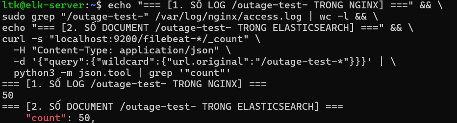

* **Giao diện Kibana Discover:** Tìm kiếm `url.original : *outage-test*` hiển thị chính xác `Documents (50)`, các trường (IP, status 404, URL) được parse đầy đủ:

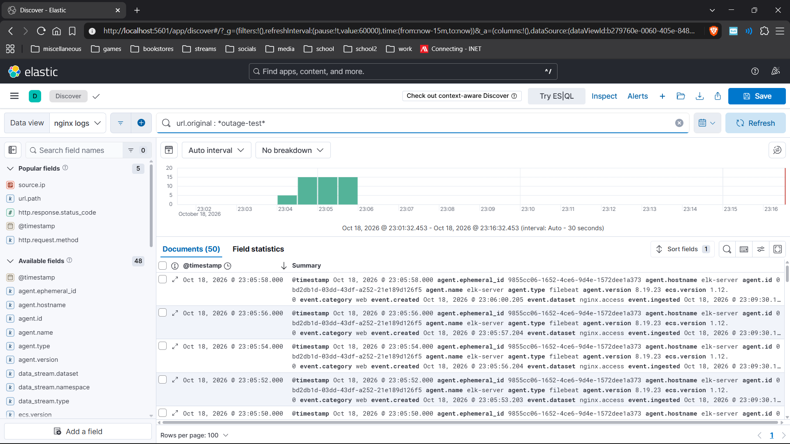
